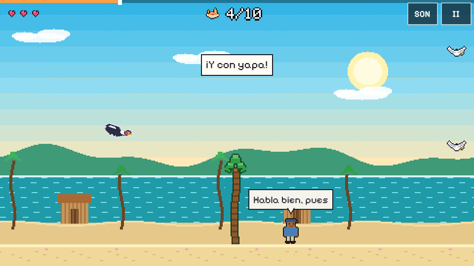
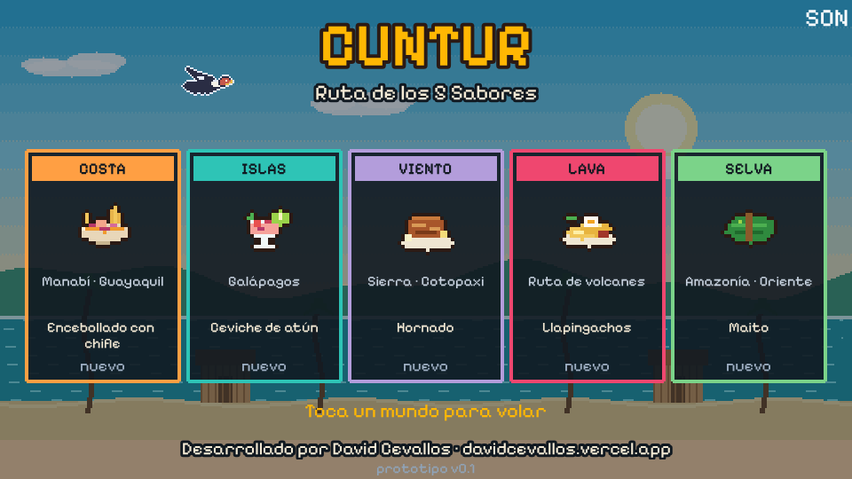
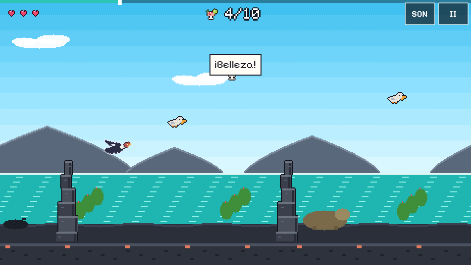
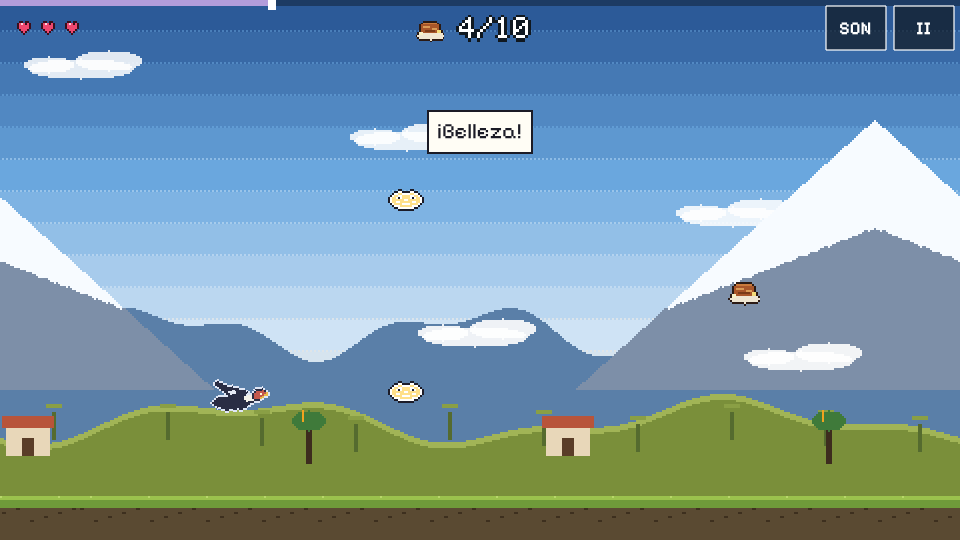
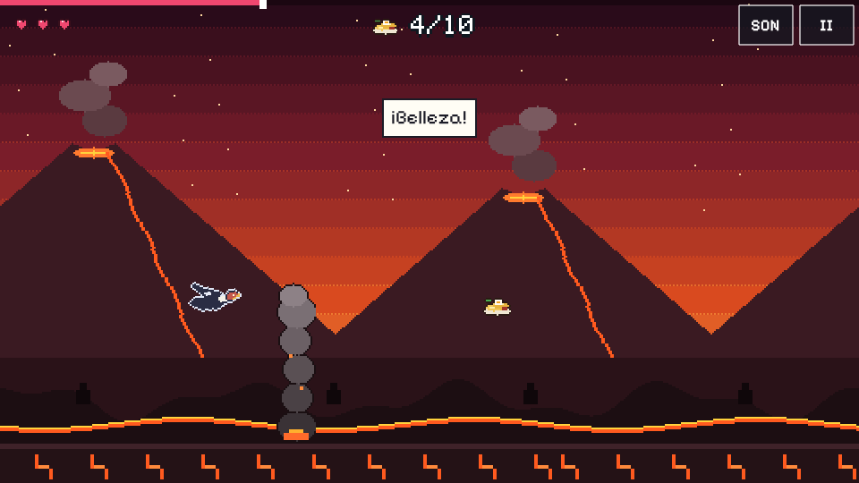
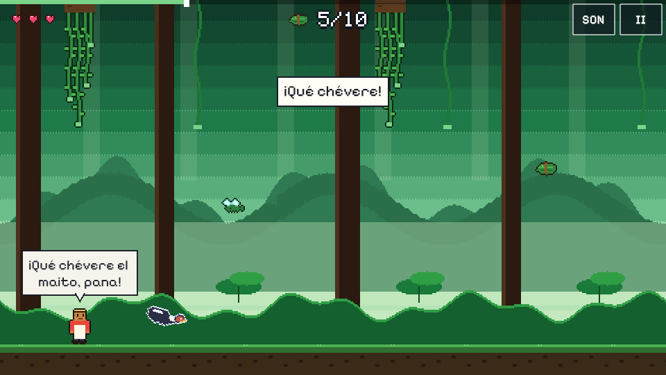
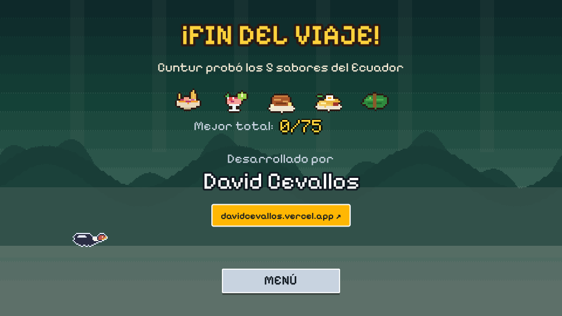

# Cuntur · Ruta de los 5 Sabores

**Un cóndor andino, cinco regiones del Ecuador y su comida típica.** Videojuego 2D de un solo toque que se juega gratis en el navegador, en el celular o en la PC.

**▶ Jugar:** https://cuntur-ruta-de-los-5-sabores.vercel.app



Desarrollado por **David Cevallos** · [davidcevallos.vercel.app](https://davidcevallos.vercel.app/)

---

## Por qué lo hice

Lo hice **en honor a mi tierra, Ecuador**. Quería un juego corto, que se entienda sin instrucciones y que un ecuatoriano reconozca de inmediato: los paisajes de cada región, la comida que se pelea en cada mesa y la forma en que hablamos. La mayoría de juegos que ven los chicos de aquí no tienen nada nuestro; este sí.

También es un proyecto técnico de portafolio: Phaser 4, TypeScript, física con paso fijo, recorridos validados para que siempre sean justos y arte y audio generados 100 % por código, sin assets de terceros.

## La historia

**Cuntur** es un cóndor chiquito con mucha hambre. El nombre viene del quechua *cúntur*, de donde sale la palabra «cóndor», y el cóndor andino es el ave nacional del Ecuador, la que está en el escudo.

Cuntur sale de la Costa con una sola idea: comerse un **encebollado con chifle**. En el camino descubre que cada región tiene su plato, su gente y sus frases, y el viaje se convierte en la *Ruta de los 5 Sabores*.

| Mundo | Región | Plato que busca | Peligros | A qué hace referencia |
|---|---|---|---|---|
| **Costa** | Manabí · Guayaquil | Encebollado con chifle | Gaviotas, palmeras | Playas manabitas, cabañas de caña y el encebollado de cada mañana |
| **Islas** | Galápagos | Ceviche de atún | Pelícanos, rocas volcánicas | Islas volcánicas, tortugas gigantes, iguanas marinas y el letrero «Respeta a la fauna» |
| **Viento** | Sierra · Cotopaxi | Hornado | Canguil volador, nubes de tormenta | El Cotopaxi nevado, el páramo y el frío serrano (*¡achachay!*) |
| **Lava** | Ruta de volcanes | Llapingachos | Bolas de lava, columnas de ceniza | La Avenida de los Volcanes y la ceniza que a veces nos cae encima |
| **Selva** | Amazonía · Oriente | Maito | Insectos, lianas | El maito envuelto en hoja de bijao, los ríos y la lluvia del Oriente |

### El chiste del canguil

En la Costa el encebollado va con **chifle**. En la Sierra muchas veces se sirve con **canguil y tostado**. Cuntur es costeño y se lo toma personal: en el mundo de Viento el canguil literalmente le vuela encima como obstáculo, y su frase de entrada es *«¿Con canguil? ¡Yo traje chifle por si acaso!»*. Es la eterna discusión costa vs. sierra, contada como juego.

### La gente de fondo

En cada mundo hay vendedoras, pescadores, cocineros, guías, señoras y niños parados al costado del camino. No se mueven ni te persiguen: solo te hablan con un globo de diálogo, como pasa cuando uno camina por un mercado. Dicen frases que cualquier ecuatoriano reconoce:

- Dichos guayacos que se volvieron virales en redes, como *«Más perdido que camarón en locro»*, *«El que no llora no mama»* o *«¡Belleza, mi ñaño!»*.
- Momentos de la televisión ecuatoriana, como el famoso *«¡Ah, es real!»*.
- Jerga de todo el país: *ñaño, pana, chévere, bacán, mande, yapa, ¡chuta!, ¡achachay!, ¡arrarray!, ¡atatay!*

Cada frase guarda en `src/content/phrases.json` de dónde viene. Las que mencionan a personas reales están desactivadas por respeto hasta decidir si se incluyen.

## Capturas

| | |
|---|---|
|  |  |
|  |  |
|  |  |

## Cómo se juega

- **Toca la pantalla, haz clic o presiona espacio** para aletear.
- Tienes **3 corazones**. Los obstáculos, el suelo y el techo te quitan uno.
- Cada mundo tiene **15 platos**: recoge al menos **10** y llega a la meta.
- Cada recorrido dura cerca de un minuto y quince segundos. Al terminar la Selva salen los créditos.
- En el celular, gíralo en horizontal.

## Tecnología

| Parte | Detalle |
|---|---|
| Motor | Phaser 4.2.1 (WebGL) + Vite + TypeScript estricto |
| Pantalla | Diseño lógico 480×270, render 960×540 con zoom 2 para pixel art y texto nítidos; escala FIT para celular y PC |
| Física | Paso fijo de 1/120 s, igual a 60 o 120 Hz |
| Recorridos | 6 segmentos diseñados a mano; cada mundo los ordena distinto y dos de ellos los espejan |
| Justicia | `npm run validate` resuelve con programación dinámica (fotograma, altura, tiempo desde el último aleteo) que cada mundo tenga una ruta con margen y que se puedan alcanzar los 15 platos |
| Arte | Pixel art procedural (`src/art`): cóndor, 10 peligros, 5 platos, 6 personajes y fondos parallax por región |
| Audio | Efectos y 6 pistas de música sintetizados con Python (`tools/gen_sfx.py`, `tools/gen_music.py`) |
| Pruebas | Playwright: un bot gana los 5 mundos; también derrota, reintento, pausa, cambio de pestaña y aviso de orientación |

## Correr el proyecto

```bash
npm install          # Node 22.18 o superior
npm run dev          # http://localhost:5173 (con --host también desde el celular en tu red)
npm run build        # genera dist/ estático
npm run validate     # comprueba que los 5 recorridos sean justos
npm test             # pruebas e2e (en tu PC: npx playwright install chromium)
```

Parámetros de URL para probar: `?world=costa|islas|viento|lava|selva`, `?debug=1`, `?g=900&f=250` (gravedad y fuerza del aleteo), `?speed=90`, `?hearts=9`, `?credits=1`.

## Estructura

```
src/
├── scenes/     Preload, Menú, Partida, Créditos
├── content/    mundos, segmentos, frases, física
├── art/        sprites y fondos generados por código
└── game/       audio, guardado, UI, simulación
tools/          validador de recorridos, generadores de música y efectos
tests/          e2e con Playwright
```

---

Hecho con cariño desde Manabí, Ecuador. © 2026 David Cevallos.
